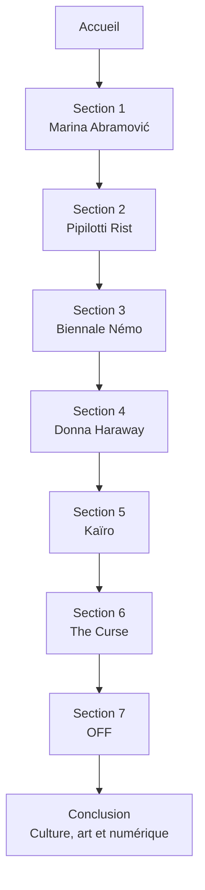
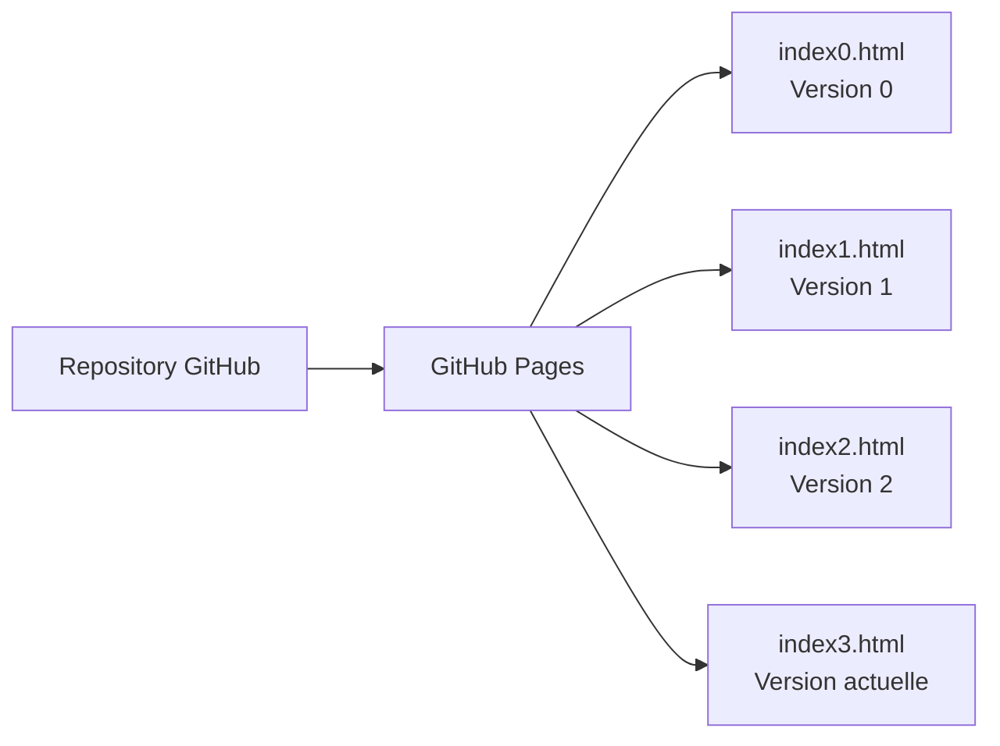
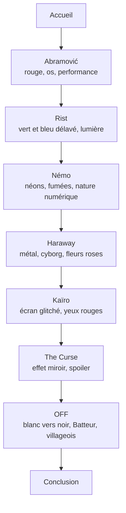

# Accueil — Archive Sensible

**Archive Sensible** est un site web de scrollytelling qui présente des
références de culture et de pop culture qui inspirent ma pensée et ma vie
au quotidien.

Le projet réunit des œuvres, des artistes, des films, des jeux et des
réflexions autour du corps, de la mémoire, de la technologie, de la solitude,
de la nature et du numérique.

## Objectif du site

Le site ne cherche pas à donner des réponses définitives. Il propose une
dérive sensible à travers des références qui se répondent :

- Le corps et la performance avec Marina Abramović.
- La lumière et l’immersion avec Pipilotti Rist.
- Le code, la nature et les identités numériques avec la Biennale Némo.
- Les frontières entre humain, animal et machine avec Donna Haraway.
- La solitude numérique avec *Kaïro*.
- La vertu performative et le malaise avec *The Curse*.
- La purification, la violence et l’absurde avec *OFF*.

## Parcours de visite

## Organisation des versions

Le dépôt conserve plusieurs versions du projet. Chaque version possède son
propre fichier HTML et peut être consultée directement depuis GitHub Pages.

## Contenu de la version actuelle

La version actuelle, `index3.html`, est un scrollytelling responsive composé
de plusieurs chapitres visuellement distincts.

## Principes de conception

- Le site est pensé pour être lu en faisant défiler la page.
- Chaque section possède une direction artistique différente.
- Les transitions entre les univers sont volontairement brutales.
- Les interactions reposent sur le scroll, le clic et le toucher.
- Le site est responsive et utilisable sur téléphone.
- Les images, vidéos et textes apparaissent progressivement au défilement.
- Le contraste est renforcé pour améliorer la lisibilité.
