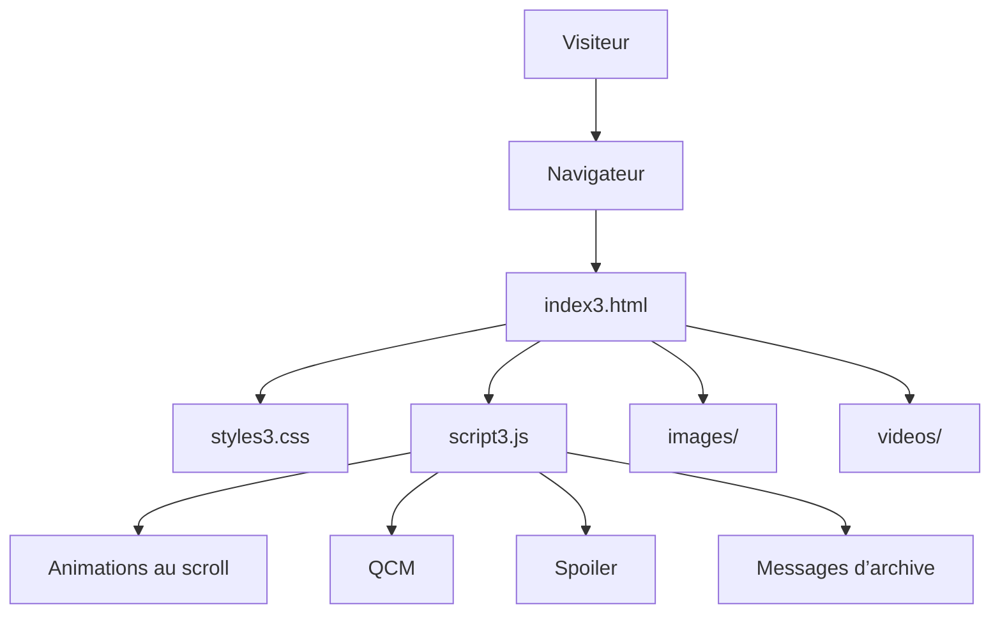
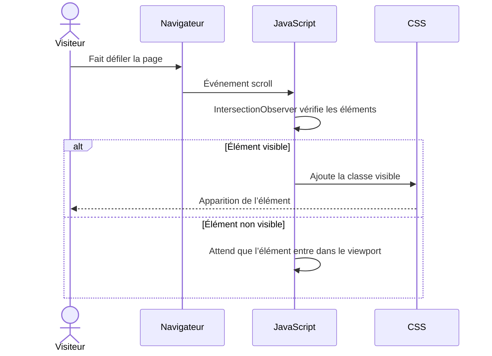
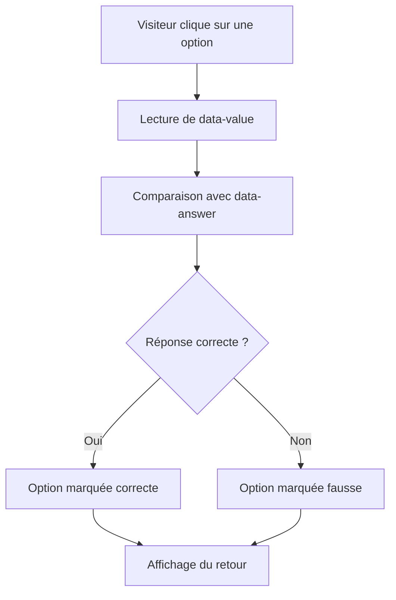
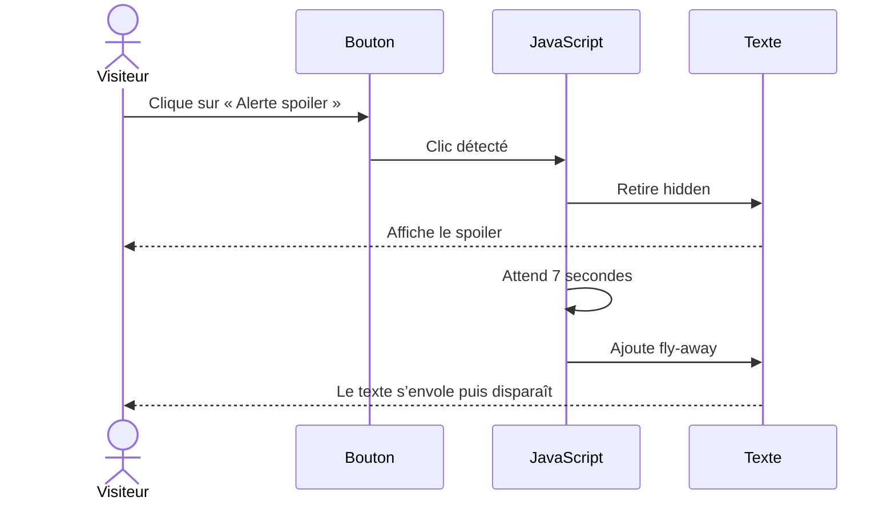
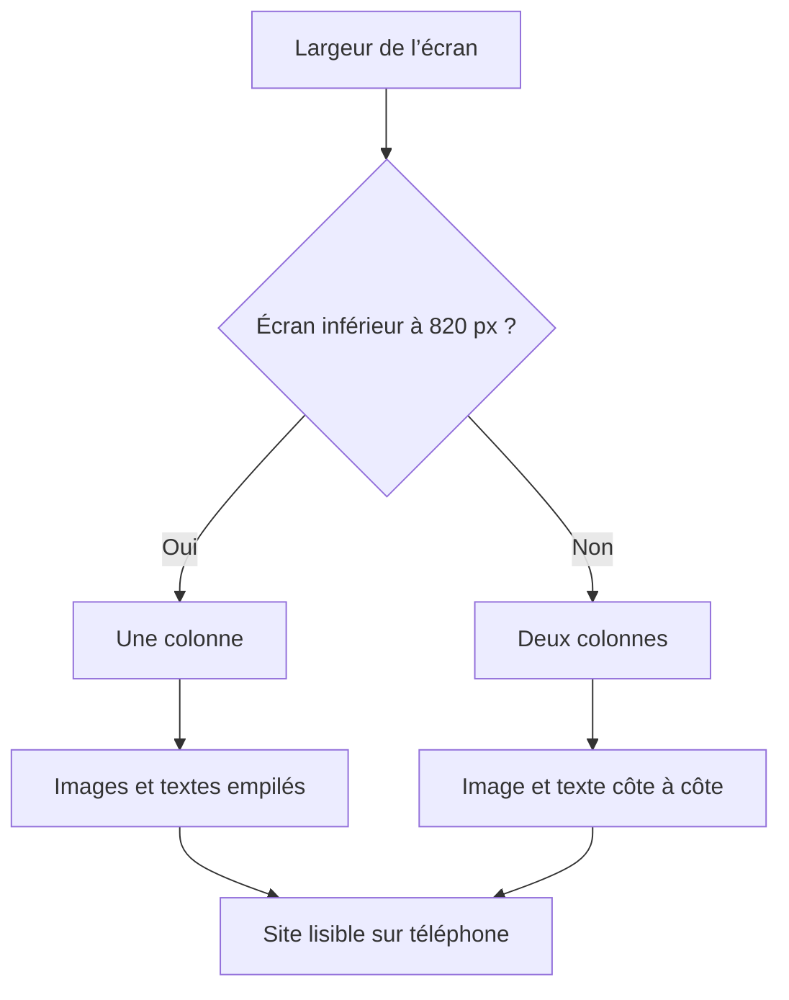
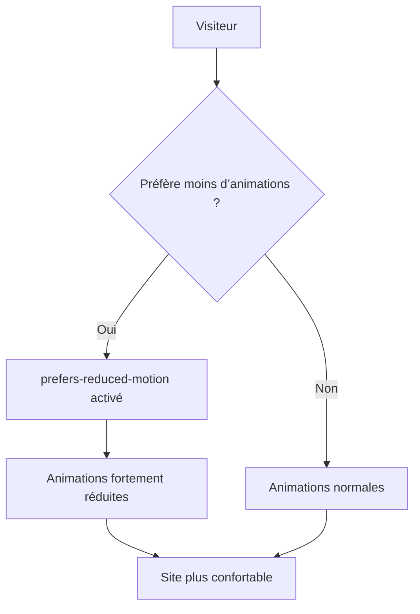
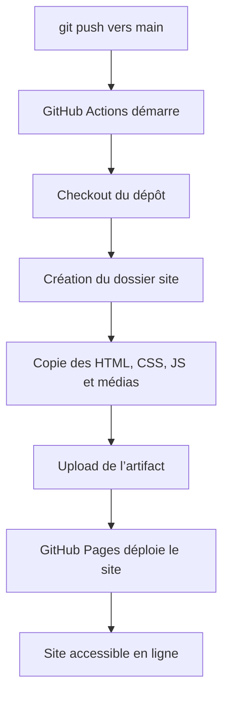

# Technique — Archive Sensible

**Archive Sensible** est un site web statique réalisé avec HTML, CSS et
JavaScript. Il ne nécessite pas de base de données, de serveur applicatif ni
de compte utilisateur.

Le site est publié avec GitHub Pages et mis à jour automatiquement à chaque
push sur la branche `main`.

## Architecture générale



## Fichiers principaux

| Fichier | Rôle |
|---|---|
| `index3.html` | Structure du site, sections, œuvres, QCM et spoiler |
| `styles3.css` | Mise en page, responsive, couleurs, animations et accessibilité |
| `script3.js` | Apparitions au scroll, QCM, spoiler et messages |
| `images/` | Images utilisées dans les différentes sections |
| `videos/` | Vidéos éventuelles intégrées au site |
| `.github/workflows/deploy.yml` | Déploiement automatique vers GitHub Pages |

## Fonctionnement du scrollytelling

Le JavaScript observe les éléments présents dans la page. Lorsqu’un élément
entre dans la zone visible du navigateur, la classe `visible` lui est ajoutée.
Le CSS déclenche alors son apparition progressive.



## QCM

Chaque QCM possède un attribut `data-answer` qui contient la bonne réponse.
Lorsque le visiteur clique sur une option, le script compare la valeur choisie
avec la bonne réponse.



## Spoiler

La section *The Curse* utilise un bouton pour révéler un texte sensible. Après
un délai, le texte reçoit une classe d’animation qui le fait monter et
disparaître.



## Responsive design

Le site utilise une mise en page flexible, des unités relatives et des media
queries. Les œuvres passent d’une colonne sur téléphone à deux colonnes sur
écran plus large.



## Accessibilité

Le site applique plusieurs principes d’accessibilité :

- Contraste renforcé entre le texte et le fond.
- `alt` sur les images.
- `aria-live` sur les retours des QCM.
- `aria-modal` sur les éventuelles fenêtres de dialogue.
- Contour de focus visible pour la navigation au clavier.
- Respect de `prefers-reduced-motion`.



## Déploiement

Le déploiement est réalisé avec GitHub Actions. Lors d’un push sur `main`, le
workflow copie les fichiers HTML, CSS, JavaScript et médias dans un dossier
`site`, puis le publie sur GitHub Pages.



## Ajouter une image

Pour ajouter une image, place le fichier dans le dossier `images/`, puis
insère une balise `` dans `index3.html`.

```mermaid
flowchart LR
    A[Image ajoutée dans images/] --> B[Balise img dans index3.html]
    B --> C[src="images/nom-du-fichier.png"]
    C --> D[Image affichée sur GitHub Pages]
```

Exemple :

```html

```
