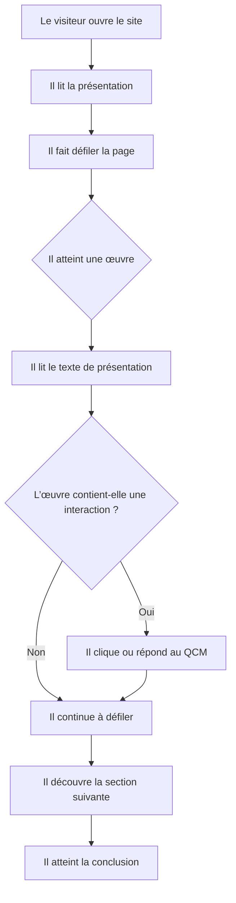
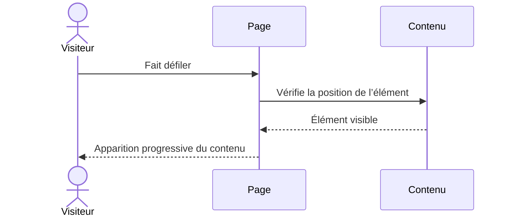
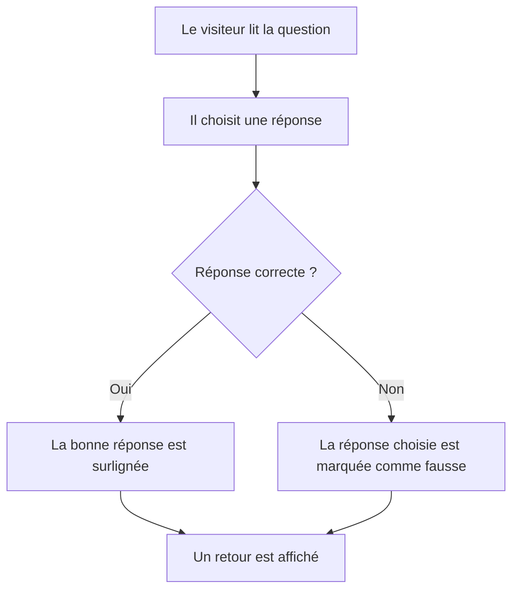
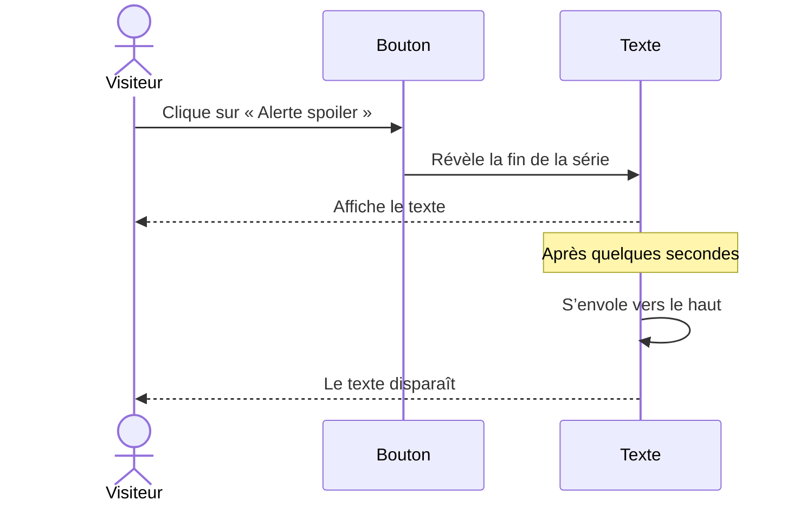
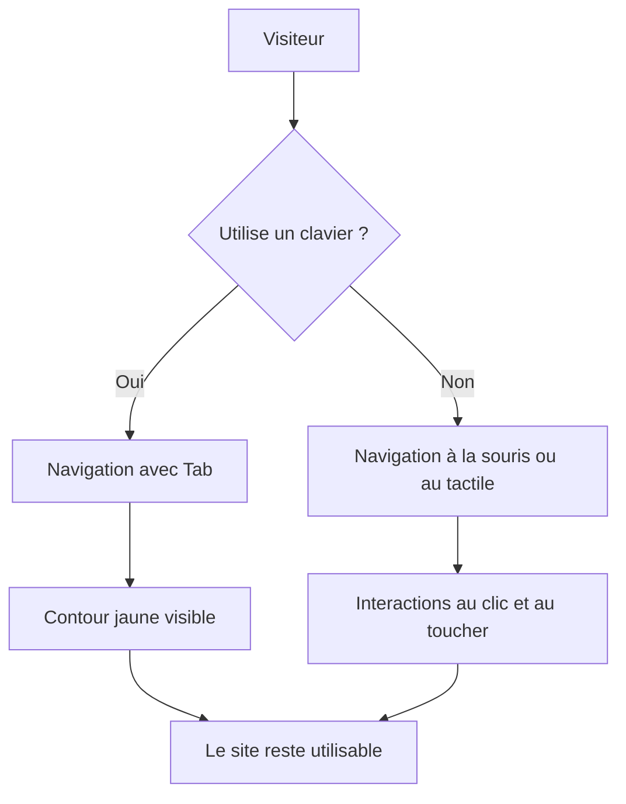

# Utilisateur — Archive Sensible

Cette documentation décrit comment un visiteur utilise le site
**Archive Sensible**.

Le site est conçu comme une expérience de lecture sensible : le visiteur fait
défiler, observe, clique sur certains éléments et découvre progressivement les
références présentées.

## Profil du visiteur

Le visiteur peut être :

- Un enseignant qui découvre le projet.
- Un camarade qui consulte les références.
- Une personne intéressée par l’art contemporain, la culture numérique ou
  la pop culture.
- Un visiteur sur ordinateur ou sur téléphone.

## Parcours utilisateur

## Interactions disponibles

### Défilement

Le défilement déclenche l’apparition progressive des œuvres, des textes et
des éléments graphiques.

### QCM

Certaines œuvres proposent une question à choix multiples. Le visiteur clique
sur une réponse, puis le site indique si elle est correcte et révèle la bonne
réponse.

### Alerte spoiler

Dans la section *The Curse*, le visiteur peut choisir de révéler la fin de la
série. Après quelques secondes, le texte révélé s’envole vers le haut et
disparaît.

## Accessibilité

Le site cherche à rester lisible et utilisable par le plus grand nombre.

- Les textes ont un contraste renforcé.
- Les éléments interactifs ont un contour de focus visible.
- Les images possèdent une description alternative.
- Les QCM annoncent leur résultat.

## Ce que le visiteur ne fait pas

Le site n’est pas un jeu avec un score, une victoire ou une défaite.

- Il n’y a pas de compte à créer.
- Il n’y a pas de bonne ou mauvaise « performance ».
- Il n’y a pas de récompense à obtenir.
- Le visiteur peut quitter à tout moment.
- Chaque section peut être lue indépendamment des autres.
